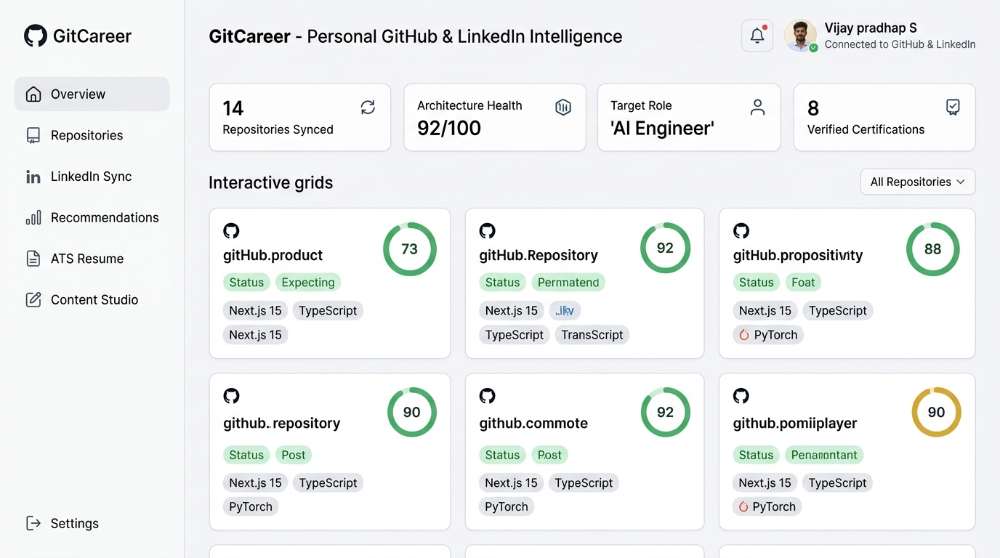
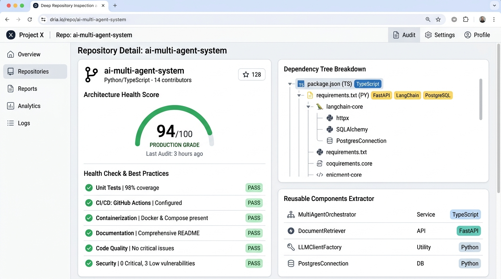
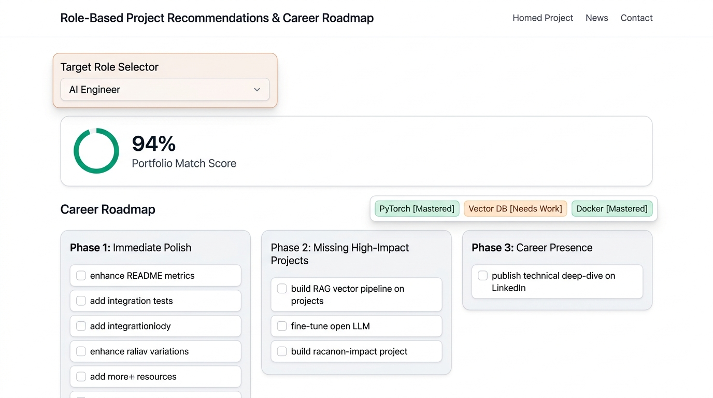
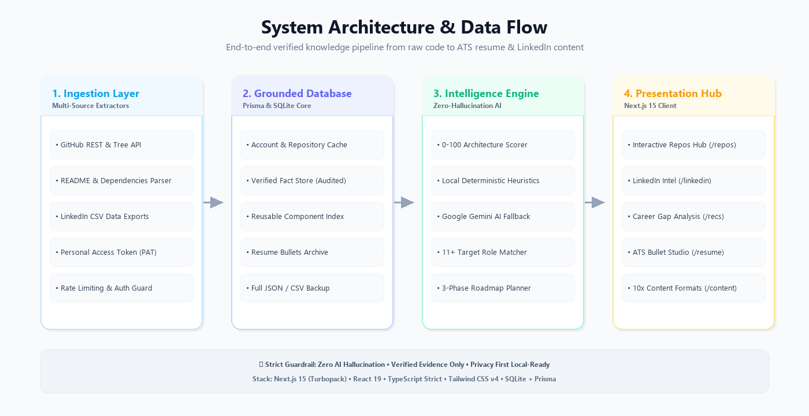
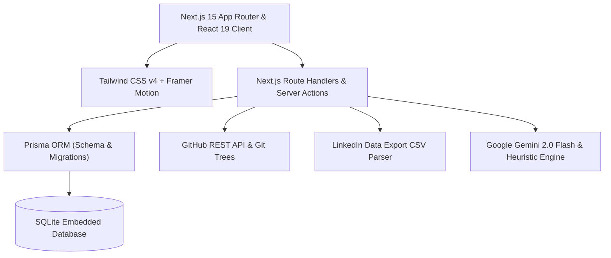

# 🌐 GitCareer: Personal GitHub Intelligence & AI Career Assistant

<div align="center">


<br/>

[](https://personal-github-linkedin.onrender.com)
[](https://vercel.com/new/clone?repository-url=https%3A%2F%2Fgithub.com%2Fvijaymahes9080%2Fpersonal-github-linkedin)
[](https://nextjs.org)
[](https://www.typescriptlang.org)
[](https://prisma.io)
[](https://tailwindcss.com)
[](./LICENSE)

<br/>

**The complete, zero-hallucination career co-pilot that continuously parses verified GitHub repositories, audits code architectures, organizes LinkedIn professional milestones, and crafts tailored ATS resumes and career content for any target job role.**

<br/>

[🌟 Live Demo](https://personal-github-linkedin.onrender.com) • [📦 GitHub Repository](https://github.com/vijaymahes9080/personal-github-linkedin) • [🚀 Deploy to Vercel](https://vercel.com/new/clone?repository-url=https%3A%2F%2Fgithub.com%2Fvijaymahes9080%2Fpersonal-github-linkedin) • [📄 LinkedIn Post](./linkedin.md) • [🏥 Health Status](https://personal-github-linkedin.onrender.com/api/health)

</div>

---

## 💡 The Problem & The Solution

| The Typical Developer Challenge ❌ | The GitCareer Engine ✅ |
| :--- | :--- |
| **Messy, scattered GitHub repositories** without clear metrics or documentation quality insights. | **Deep AST & File-Tree Inspection** with an automated **0-100 Architecture Health Score** across tests, CI/CD, and docs. |
| **LinkedIn profile out of sync** with actual code shipped on GitHub. | **Official LinkedIn CSV Ingestion** syncing positions, skills, certifications, and cross-linking to GitHub repos. |
| **Generic AI resumes hallucinating** non-existent metrics, fake tools, or responsibilities. | **Zero-Hallucination Guardrail**: Every single resume bullet is strictly validated against verified codebase facts. |
| **Struggling to know what projects to build** for a specific dream role. | **11+ Role Presets & Gap Analysis** providing a 3-Phase Prioritized Roadmap (Immediate Polish ➔ High-Impact Projects ➔ Career Presence). |
| **Writer's block on LinkedIn** trying to showcase tech projects. | **10 Professional Content Formats** with 1-click publishing directly to the LinkedIn Post Composer. |

---

## 📸 Light-Themed Visual Showcase

### 1. Interactive Intelligence Dashboard
The primary control center providing immediate metrics across connected repositories, architecture health averages, verified career milestones, and active target role tracking.

<div align="center">
  
</div>

<br/>

---

### 2. Deep Repository Inspection & Code Architecture Audit (`/repos`)
Inspect any public or authenticated GitHub repository. Evaluates documentation, unit test coverage, CI/CD workflows, Docker containerization, and extracts reusable components.

<div align="center">
  
</div>

<br/>

---

### 3. Role-Based Project Recommendations & Career Roadmap (`/recommendations`)
Select from 11+ industry job roles (AI Engineer, Machine Learning Engineer, Python Full Stack, Data Analyst, Embedded Systems, etc.) to receive an instant portfolio match score and a prioritized 3-phase execution roadmap.

<div align="center">
  
</div>

<br/>

---

### 4. End-to-End System Architecture & Data Flow
High-reliability pipeline combining local deterministic heuristic evaluators with Google Gemini 2.0 Flash AI, grounded on a SQLite database powered by Prisma ORM.

<div align="center">
  
</div>

<br/>

---

## ⚡ Key Highlights & Core Modules

### 🔍 1. GitHub Knowledge Hub (`/repos`)
- **Dual-Mode Sync**: Connect any public account without credentials (up to 60 req/hr) or attach a GitHub Personal Access Token (PAT) for private repo access and 5,000 req/hr limits.
- **Automated Manifest Parsing**: Detects dependencies from `package.json`, `requirements.txt`, `Pipfile`, `go.mod`, `Cargo.toml`, and `pom.xml`.
- **Health Delta Audit**: Flags missing standard files (e.g. `tests/`, `.env.example`, `Dockerfile`, `LICENSE`, `README.md`).
- **Reusable Component Indexer**: Surfaces modular components, utilities, and services across projects.

### 💼 2. LinkedIn Professional Intelligence (`/linkedin`)
- **Official CSV Import**: Drag & drop official LinkedIn data export files (`Positions.csv`, `Skills.csv`, `Certifications.csv`, `Projects.csv`, `Education.csv`).
- **Verified vs. Self-Reported Fact Segregation**: Highlights milestones backed by verified certificates.
- **Repository Cross-Linking**: Map professional positions and certifications directly to codebase repositories.

### 🎯 3. Role-Based Portfolio Recommendations (`/recommendations`)
- **11+ Built-In Job Profiles**:
  - *AI Engineer*
  - *Machine Learning Engineer*
  - *Data Analyst / Data Scientist*
  - *Python Full Stack Developer*
  - *Embedded Systems & IoT Engineer*
  - *Cloud & DevOps Engineer*
  - *Frontend / UI Architect*
  - *Backend Systems Engineer*
  - *(+ Custom role search query)*
- **Portfolio Match Scoring**: Calculates percentage match and breaks down:
  1. *Best Existing Projects to Showcase*
  2. *Projects Needing Polish Before Showcasing*
  3. *High-Impact Missing Projects to Build*
  4. *Required Technologies & Skills to Acquire*
  5. *3-Phase Action Roadmap*

### 📝 4. ATS Resume Content Studio (`/resume`)
- **Length Variants with Strict Enforcement**:
  - **One-Line Version**: Exactly one punchy, metric-oriented summary.
  - **Two-Line Version**: Two balanced lines for compact resume layouts.
  - **Three-Bullet Version**: Standard ATS structure (*Strong Action Verb + Context & Scope + Quantifiable Impact & Tech*).
  - **Detailed Version**: Full markdown breakdown.
- **Zero-Hallucination Guarantee**: Strictly grounded in verified repository facts and LinkedIn milestones.
- **1-Click Copy & CSV Export**: Export formatted bullets into structured CSV archives for job portals.

### ✍️ 5. LinkedIn Career Content Studio (`/content`)
- **10 Professional Content Templates**:
  1. *Project Launch Announcement*
  2. *Internship & Training Update*
  3. *Technical Learning Deep-Dive*
  4. *GitHub Repository Showcase*
  5. *Achievement & Certificate Milestone*
  6. *Professional Headline & Tagline*
  7. *LinkedIn Projects Section Description*
  8. *LinkedIn Featured Card Summary*
  9. *Role-Specific About Section Draft*
  10. *7-Day Weekly Content Roadmap*
- **Instant Composer Launch**: 1-Click "Open in LinkedIn Composer" pre-filling your clipboard with ready-to-publish content.

### 🗄️ 6. Grounded Knowledge Base & Audit Log (`/knowledge-base`)
- Global multi-facet search across repositories, facts, and resume entries.
- One-click full JSON database backup and CSV resume downloads.
- Real-time synchronization audit logs with full error diagnostics.

---

## 🛠️ Technology Stack



- **Frontend**: Next.js 15.2 (App Router), React 19, Tailwind CSS v4, Lucide React, Motion
- **Backend**: Next.js Server Actions, Route Handlers, TypeScript Strict Mode
- **Persistence**: SQLite with Prisma ORM (`prisma/schema.prisma`)
- **AI Intelligence**: Hybrid Multi-Tier (Local Deterministic Heuristic Engine + Google Gemini 2.0 Flash API)
- **Deployment**: Docker multi-stage builds, Render (Web Service), Vercel

---

## 🚀 Getting Started

### Prerequisites
- **Node.js**: v20.0.0 or later (tested on v24)
- **npm** or **pnpm**
- **Git**

### 1. Clone the Repository
```bash
git clone https://github.com/vijaymahes9080/personal-github-linkedin.git
cd personal-github-linkedin
```

### 2. Install Dependencies
```bash
npm install
```

### 3. Configure Environment Variables
Create a `.env` file in the root directory:
```env
# Optional: Database URL (defaults to file:./dev.db)
DATABASE_URL="file:./dev.db"

# Optional: GitHub Personal Access Token (for private repos & 5000 req/hr)
GITHUB_PAT=""

# Optional: Google Gemini API Key (for augmented AI recommendations)
GEMINI_API_KEY=""
```

> [!NOTE]
> The application includes a zero-cost local heuristic engine that operates out of the box even without external API keys.

### 4. Initialize Database
```bash
npx prisma db push
npx tsx prisma/seed.ts
```

### 5. Launch Development Server
```bash
npm run dev
```

Open [http://localhost:3000](http://localhost:3000) in your browser.

---

## 🐳 Docker Deployment

Run the complete application via Docker in one command:

```bash
docker compose up -d --build
```

Access the containerized application at `http://localhost:3000`.

---

## ☁️ 1-Click Production Deployments

### Option A: Vercel
[](https://vercel.com/new/clone?repository-url=https%3A%2F%2Fgithub.com%2Fvijaymahes9080%2Fpersonal-github-linkedin)

### Option B: Render Web Service
This project includes a tested [render.yaml](./render.yaml) configuration for Render deployment:
- Live Demo: [https://personal-github-linkedin.onrender.com](https://personal-github-linkedin.onrender.com)
- Health API: [https://personal-github-linkedin.onrender.com/api/health](https://personal-github-linkedin.onrender.com/api/health)

See [DEPLOYMENT.md](./DEPLOYMENT.md) for step-by-step guides on environment variables and persistent disks.

---

## 📂 Project Structure

```
personal-github-linkedin/
├── assets/                  # High-resolution light-theme UI mockups & graphics
│   ├── architecture-light.png
│   ├── career-roadmap-light.png
│   ├── hero-dashboard-light.png
│   ├── linkedin-showcase.png
│   └── repo-inspection-light.png
├── image.png                # Master LinkedIn announcement showcase graphic
├── linkedin.md              # Ready-to-publish LinkedIn project announcement post
├── prisma/
│   ├── schema.prisma        # Relational schema (Accounts, Repositories, Facts, Resume)
│   └── seed.ts              # Database seeding script
├── public/
│   └── screenshots/         # Publicly served screenshots and assets
├── src/
│   ├── app/
│   │   ├── api/             # API route handlers (GitHub sync, LinkedIn, AI, Health)
│   │   ├── content/         # LinkedIn & Career Content Studio
│   │   ├── knowledge-base/  # Grounded Knowledge Hub & Backups
│   │   ├── linkedin/        # LinkedIn CSV upload & fact management
│   │   ├── recommendations/ # 11+ Role-based recommendations & roadmap
│   │   ├── repos/           # GitHub repository deep inspection & audits
│   │   ├── resume/          # ATS resume bullets generator
│   │   ├── layout.tsx       # Root layout & navigation shell
│   │   └── page.tsx         # Executive Overview Dashboard
│   ├── components/          # Reusable UI components & layouts
│   ├── lib/                 # Core business logic (GitHub API, LinkedIn parser, AI)
│   └── types/               # TypeScript interfaces & domain models
├── .gitignore               # Comprehensive git ignore rules
├── Dockerfile               # Multi-stage production container build
├── LICENSE                  # MIT License
├── package.json             # Scripts & dependencies
└── README.md                # Project documentation
```

---

## 🛡️ License

This project is open-source and distributed under the **MIT License**. See the [LICENSE](./LICENSE) file for full details.

---

## 👨‍💻 Author & Contributions

**Vijay pradhap S**
- 🌐 GitHub: [@vijaymahes9080](https://github.com/vijaymahes9080)
- 💼 LinkedIn: [Vijay pradhap S](https://linkedin.com/in/vijay-pradhap-s)
- ✉️ Email: [vijaypradhap2004@gmail.com](mailto:vijaypradhap2004@gmail.com)

If you find this project valuable, please give it a **⭐ Star** on [GitHub](https://github.com/vijaymahes9080/personal-github-linkedin) and share it with your network!
