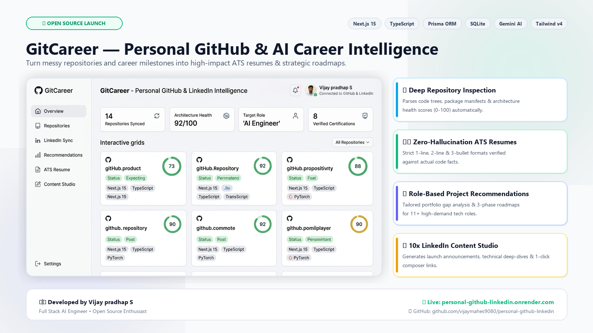

# 🚀 LinkedIn Announcement Post: GitCareer

> **Image Asset for Post**: Attach [`image.png`](./image.png) (also available at [`./assets/linkedin-showcase.png`](./assets/linkedin-showcase.png)) when publishing on LinkedIn for maximum visual engagement.

<div align="center">



</div>

---

## 📌 Master LinkedIn Post (Recommended — Ready to Copy & Paste)

Copy the text below and paste it directly into your [LinkedIn Post Composer](https://www.linkedin.com/feed/):

```markdown
🚀 Excited to launch GitCareer — Personal GitHub & AI Career Intelligence! 🌐

As developers, we build dozens of repositories, push thousands of commits, and earn certifications... but when applying for jobs, our portfolios and resumes never reflect the real quality of our code.

Even worse? Most generic AI resume tools make up fake numbers, hallucinate libraries you never touched, and produce bland copy.

That’s why I built GitCareer: an open-source, zero-hallucination career co-pilot that bridges your actual GitHub codebase with your LinkedIn professional history.

Here is what GitCareer does:

🔍 Deep Repository Inspection & Code Health Audit
Automatically parses your GitHub repos, evaluates dependency manifests (package.json, requirements.txt, go.mod), and generates an automated 0–100 Architecture Health Score based on tests, CI/CD, containerization, and clean structure.

💼 LinkedIn Professional Intelligence
Drag & drop official LinkedIn CSV exports (Positions, Skills, Certifications, Projects) to establish an audited, verified record of your career milestones and link them directly to GitHub repos.

🛡️ Zero-Hallucination ATS Resume Studio
Generates strict 1-line, 2-line, and 3-bullet resume entries mathematically grounded on your real code trees. Never hallucinates metrics or responsibilities.

🎯 Role-Based Project Recommendations & Roadmaps
Select from 11+ target roles (AI Engineer, Machine Learning, Python Full Stack, Embedded, Data Analyst, etc.) to get an instant Portfolio Match Score and a prioritized 3-phase execution roadmap:
1️⃣ Immediate Polish
2️⃣ High-Impact Missing Projects to Build
3️⃣ Career Presence & Technical Writing

✍️ 10x Career Content Studio
10 ready-to-publish formats (Project Launch, Technical Deep Dives, GitHub Showcases, Milestones) with 1-click publishing directly to the LinkedIn Composer.

🛠️ The Tech Stack:
• Frontend: Next.js 15.2 (App Router, Turbopack) & React 19
• Language: TypeScript (Strict)
• Styling: Tailwind CSS v4 & Framer Motion
• Database & ORM: SQLite with Prisma ORM
• Intelligence: Local Heuristic Engine + Google Gemini 2.0 Flash
• Deployment: Docker & Render (with 1-Click Vercel Deploy)

🌐 Test the Live Application:
https://personal-github-linkedin.onrender.com

📦 Star the Project on GitHub:
https://github.com/vijaymahes9080/personal-github-linkedin

🚀 1-Click Vercel Deploy:
https://vercel.com/new/clone?repository-url=https%3A%2F%2Fgithub.com%2Fvijaymahes9080%2Fpersonal-github-linkedin

I’d love your feedback! Try connecting your GitHub profile or drop your target role in the comments below. What feature would help your career search most?

#WebDevelopment #Nextjs #TypeScript #OpenSource #AI #SoftwareEngineering #CareerGrowth #DeveloperTools #GitHub #LinkedIn #Portfolio #TechCareers
```

---

## ⚡ Alternative Variations

<details>
<summary><b>Variation 2: Short & Punchy (High Engagement)</b></summary>

```markdown
Most AI resume builders have one fatal flaw: they hallucinate. ❌

They invent metrics you never achieved and tools you never used.

I wanted something grounded in cold, hard code evidence. So I built GitCareer 🚀

It connects to your GitHub account & LinkedIn export to:
✅ Audit your repositories with a 0-100 Architecture Health Score
✅ Extract reusable components & test coverage
✅ Generate ATS bullets with ZERO hallucination
✅ Benchmark your portfolio against 11+ job roles (AI Engineer, Full Stack, Data Scientist)
✅ Generate ready-to-post LinkedIn technical updates

Built with Next.js 15, TypeScript, SQLite/Prisma, and Google Gemini AI.

Check out the live demo & star the repo:
🌐 Live App: https://personal-github-linkedin.onrender.com
📦 GitHub: https://github.com/vijaymahes9080/personal-github-linkedin

Let me know what target role you're currently aiming for! 👇

#OpenSource #Nextjs #AI #SoftwareEngineering #GitHub
```

</details>

<details>
<summary><b>Variation 3: Engineering Deep-Dive (For Engineering Leaders & Architects)</b></summary>

```markdown
Engineering Spotlight: Building a Zero-Hallucination Knowledge Engine for Software Engineers 🛠️

When designing GitCareer, the hardest architectural challenge wasn't calling an LLM—it was eliminating hallucinations completely.

Here is the engineering approach I implemented:

1. Deterministic Grounding First
Instead of passing vague prompts to an LLM, the backend directly clones and parses Git trees, dependencies (package.json, requirements.txt, go.mod), Dockerfiles, and CI/CD pipelines via GitHub REST API.

2. Verified Fact Segregation
Imported LinkedIn CSV data is categorized into "Verified Facts" (backed by certificates or exports) vs "Self-Reported Notes".

3. Constrained Output Generation
The ATS Resume Studio enforces mathematical length and structure constraints (Action Verb + Task Scope + Verifiable Impact).

Tech highlights:
- Next.js 15 App Router & React 19
- Strict TypeScript throughout
- Prisma ORM over SQLite with full JSON/CSV export backups
- Multi-stage Docker containerization

Try the live version: https://personal-github-linkedin.onrender.com
Full code on GitHub: https://github.com/vijaymahes9080/personal-github-linkedin

Feedback and PRs are warmly welcomed!

#SystemDesign #TypeScript #Nextjs #SoftwareArchitecture #OpenSource
```

</details>

---

## 📋 Tips for Publishing on LinkedIn

1. **Attach the Image**: Click the image icon on LinkedIn and upload [`image.png`](./image.png) directly from this repository root.
2. **First Comment**: Drop the GitHub repo link and Live App link in the first comment for additional algorithm visibility.
3. **Engage with Early Commenters**: Respond to the first 5-10 comments within the first 60 minutes to boost post momentum.
